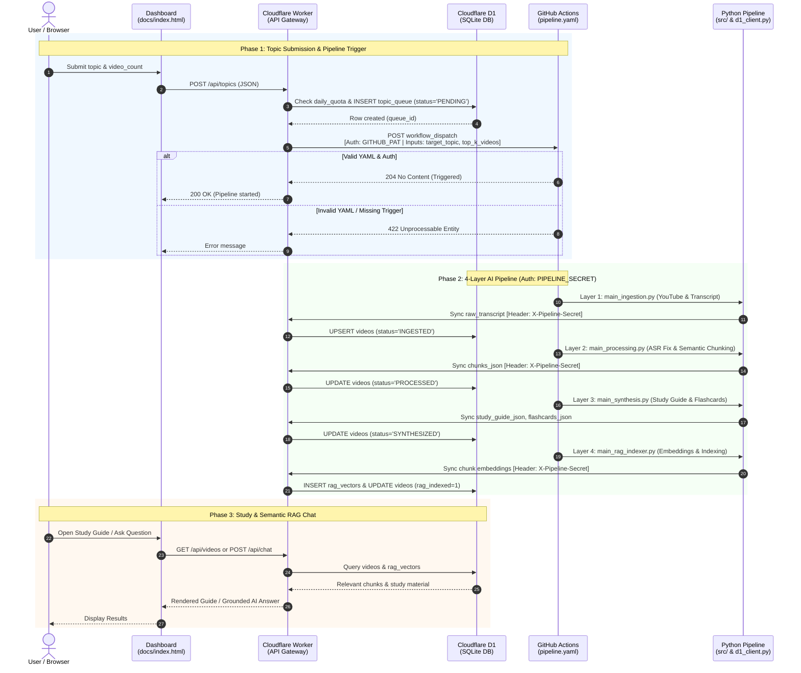

# EduExtract AI Serverless 4-Layer Educational Pipeline & Edge RAG Platform

EduExtract AI turns educational YouTube lectures and topics into structured study guides, interactive 3D flashcards, and semantic RAG knowledge bases on a near-zero-cost serverless stack. It pairs a **Cloudflare Worker** API gateway and **Cloudflare D1** relational database with a **4-layer Python processing pipeline** automated via **GitHub Actions**.

---

## Architecture Overview

* **Frontend Dashboard (`docs/index.html`)**: Interactive study workspace with study guide viewer, 3D flashcards, RAG AI tutor chat, pipeline telemetry/QA view, and topic/URL submission modal.
* **Edge API Gateway (`worker.js`)**: Cloudflare Worker handling dashboard routes, daily quota enforcement, GitHub `workflow_dispatch` triggering, Gemini-backed semantic search/RAG chat, and secret-authenticated pipeline endpoints.
* **Relational & Vector Persistence (`schema.sql` / Cloudflare D1)**: SQLite-compatible D1 database organized around four core tables: `videos`, `rag_vectors`, `topic_queue`, and `daily_quota`.
* **4-Layer Python Pipeline (`src/`)**:
  1. **Layer 1 — Ingestion (`src/main_ingestion.py`)**: Resolves topics or YouTube URLs/IDs and ingests transcripts/metadata (`status = 'INGESTED'`).
  2. **Layer 2 — Processing (`src/main_processing.py`)**: Cleans ASR transcripts, restores punctuation, and builds semantic chunks (`status = 'PROCESSED'`).
  3. **Layer 3 — Synthesis (`src/main_synthesis.py` & `src/prompts.py`)**: Generates study guide sections, flashcards, and LLM-as-a-Judge evaluation/compute telemetry (`status = 'SYNTHESIZED'`).
  4. **Layer 4 — RAG Indexing (`src/main_rag_indexer.py`)**: Generates 768-D embeddings and indexes vectors into D1 (`rag_vectors`, `rag_indexed = 1`) and optional Qdrant storage.
* **CI/CD Automation (`.github/workflows/pipeline.yaml`)**: Runs the 4-layer pipeline on a daily schedule (`cron`) or on manual/API `workflow_dispatch` triggers.

---

## UML Sequence Diagram



---

## Repository Structure

```text
eduextract-llm-pipeline/
├── .github/
│   └── workflows/
│       └── pipeline.yaml          # GitHub Actions workflow for Layers 1-4
├── docs/
│   ├── index.html                 # Web dashboard UI
│   └── eduextract_dfd_architecture.png
├── src/
│   ├── d1_client.py               # Authenticated client for Worker pipeline endpoints
│   ├── main_ingestion.py          # Layer 1: Discovery & transcript ingestion
│   ├── main_processing.py         # Layer 2: Cleaning & semantic chunking
│   ├── main_synthesis.py          # Layer 3: Study guide, flashcards & QA telemetry
│   ├── main_rag_indexer.py        # Layer 4: Embeddings & vector indexing
│   └── prompts.py                 # Prompt templates for synthesis & evaluation
├── requirements.txt               # Python dependencies
├── schema.sql                     # D1 database schema contract
├── .env.example                   # Environment & secret variable contract
└── README.md                      # Project documentation
```

---

## Database Schema Contract (`schema.sql`)

```sql
-- EduExtract D1 Database Schema (Single Source of Truth)

CREATE TABLE IF NOT EXISTS videos (
    id TEXT PRIMARY KEY,
    title TEXT NOT NULL,
    topic TEXT DEFAULT 'General',
    status TEXT NOT NULL DEFAULT 'INGESTED', -- INGESTED | PROCESSED | SYNTHESIZED | INDEXED | FAILED
    raw_transcript TEXT,
    chunks_json TEXT,
    study_guide_json TEXT,
    flashcards_json TEXT,
    telemetry_json TEXT,
    char_count INTEGER DEFAULT 0,
    flashcard_count INTEGER DEFAULT 0,
    rag_indexed INTEGER DEFAULT 0,
    error_log TEXT,
    updated_at TEXT NOT NULL
);

CREATE TABLE IF NOT EXISTS rag_vectors (
    chunk_id TEXT PRIMARY KEY,
    video_id TEXT NOT NULL,
    video_title TEXT,
    topic TEXT,
    section_title TEXT,
    chunk_type TEXT,
    content TEXT NOT NULL,
    embedding_json TEXT,
    embedding_model TEXT,
    indexed_at TEXT NOT NULL
);

CREATE TABLE IF NOT EXISTS topic_queue (
    id INTEGER PRIMARY KEY AUTOINCREMENT,
    topic TEXT NOT NULL,
    video_count INTEGER NOT NULL DEFAULT 3,
    status TEXT NOT NULL DEFAULT 'PENDING', -- PENDING | PROCESSING | COMPLETED | FAILED
    requested_at TEXT NOT NULL,
    processed_at TEXT
);

CREATE TABLE IF NOT EXISTS daily_quota (
    date_utc TEXT PRIMARY KEY,
    videos_used INTEGER NOT NULL DEFAULT 0,
    updated_at TEXT NOT NULL
);

CREATE INDEX IF NOT EXISTS idx_videos_status ON videos(status);
CREATE INDEX IF NOT EXISTS idx_topic_queue_status ON topic_queue(status);
CREATE INDEX IF NOT EXISTS idx_rag_vectors_video_id ON rag_vectors(video_id);
```

---

## Environment & Secrets Contract (`.env.example`)

```dotenv
# ==========================================
# EduExtract Environment Variables Contract
# Copy to .env for local runs. NEVER commit real secrets.
# ==========================================

# --- Shared Authentication (Must match in BOTH GitHub Secrets & Cloudflare Worker) ---
PIPELINE_SECRET=replace_with_a_strong_shared_secret
CLOUDFLARE_WORKER_URL=https://eduextract-chat.ssa210819.workers.dev

# --- GitHub Actions / Python Pipeline Secrets ---
GEMINI_API_KEY=your_gemini_api_key
GROQ_API_KEY=your_groq_api_key
YOUTUBE_API_KEY=your_youtube_api_key
YOUTUBE_COOKIES_B64=optional_base64_cookies
YOUTUBE_PROXY_URL=optional_proxy_url

# --- Pipeline Runtime Defaults (Optional for local testing) ---
TARGET_TOPIC=quantum computing
TOP_K_VIDEOS=2

# --- Cloudflare Worker Secrets (Set in Cloudflare Dashboard -> Settings -> Variables) ---
# Note: D1 database binding (DB) is configured in Cloudflare Bindings
GITHUB_PAT=github_pat_with_actions_write_permission
GITHUB_OWNER=1382sahar
GITHUB_REPO=eduextract-llm-pipeline
GITHUB_BRANCH=main
```

---

## Setup & Deployment

1. **Provision Cloudflare D1**: Create a D1 database and apply `schema.sql` using the D1 SQL console or Wrangler CLI.
2. **Deploy Cloudflare Worker**: Configure the `DB` binding and Worker secrets/variables (`PIPELINE_SECRET`, `GEMINI_API_KEY`, `GITHUB_PAT`, `GITHUB_OWNER`, `GITHUB_REPO`, `GITHUB_BRANCH`), then deploy `worker.js`.
3. **Configure GitHub Secrets**: Add repository secrets (`PIPELINE_SECRET`, `GEMINI_API_KEY`, `GROQ_API_KEY`, and any optional YouTube ingestion keys) so `.github/workflows/pipeline.yaml` can execute Layers 1–4.
4. **Access the Dashboard**: Open the deployed Cloudflare Worker URL (or host `docs/index.html` separately via Cloudflare Pages with build output directory `docs`).
